<div align="center">

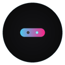

# Dynamic Island

**A Dynamic Island for your desktop.**<br>
A small floating pill that grows to show what is playing, new notifications, volume, charging and system status.

[](../../releases/latest)
[](LICENSE)
[](#install)
[](#build-from-source)

<br>

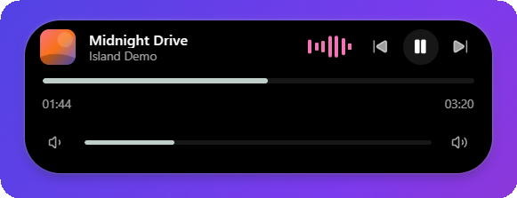

<br>

[**Download**](../../releases/latest) &nbsp;·&nbsp; [Features](#features) &nbsp;·&nbsp; [Install](#install) &nbsp;·&nbsp; [Platform support](#platform-support) &nbsp;·&nbsp; [Build](#build-from-source)

</div>

<br>

## Features

The island sits at the top centre of your screen. Point at it to open it, click for the full panel, move away and it
shrinks back to a pill.

<table>
  <tr>
    <td align="center" width="50%">
      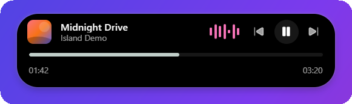<br>
      <b>Now playing</b><br>
      <sub>Title, artist and artwork from Spotify, browsers and other players. Play, pause, skip and seek.</sub>
    </td>
    <td align="center" width="50%">
      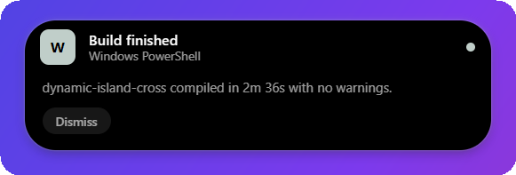<br>
      <b>Notifications</b><br>
      <sub>New Windows notifications slide in, then leave. Hidden during Do Not Disturb. Previews can be turned off.</sub>
    </td>
  </tr>
  <tr>
    <td align="center">
      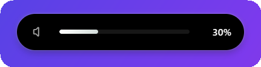<br>
      <b>Volume</b><br>
      <sub>Follows your real system volume from the keyboard keys, Windows settings or a device. Drag it to change it.</sub>
    </td>
    <td align="center">
      <br>
      <b>Charging</b><br>
      <sub>An animation when the charger is connected, removed, or the battery is full.</sub>
    </td>
  </tr>
  <tr>
    <td align="center">
      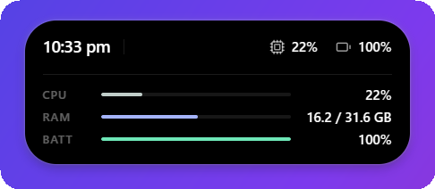<br>
      <b>System status</b><br>
      <sub>Time, CPU, memory and battery, sized exactly to its content.</sub>
    </td>
    <td align="center">
      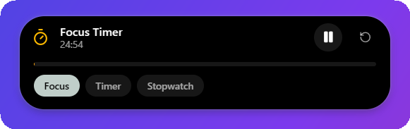<br>
      <b>Timer</b><br>
      <sub>Focus timer, countdown and stopwatch you can start and pause from the island.</sub>
    </td>
  </tr>
</table>

Also: microphone and camera indicators, auto-hide, hiding in fullscreen apps, light and dark themes, an accent colour,
launch at startup and a global show / hide shortcut.

<details>
<summary><b>More screenshots</b></summary>
<br>
<div align="center">
  
  &nbsp;
  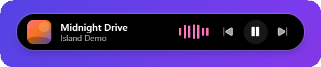
  &nbsp;
  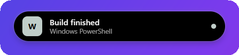
  <br><br>
  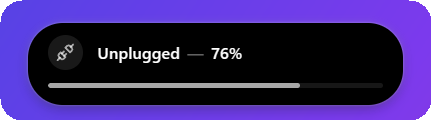
  &nbsp;
  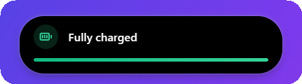
</div>
</details>

## Settings

Right-click the island, or use the tray icon, to open settings.

<div align="center">
  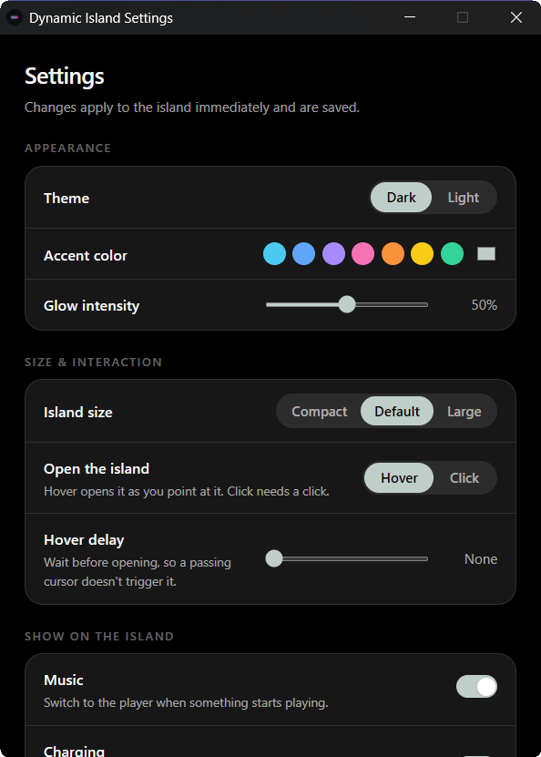
  &nbsp;&nbsp;
  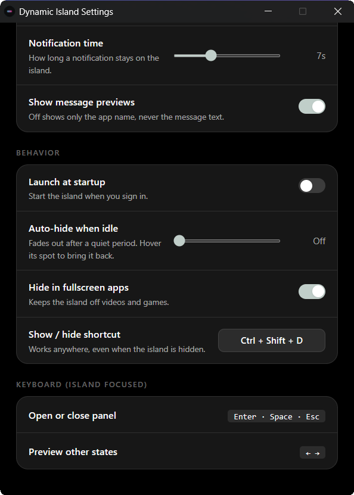
</div>

<br>

Changes apply to the island immediately. Settings are saved to `settings.json` in your user config folder. Nothing is
sent anywhere: media and notification information only travels from the system to the island on your own machine.

## Install

Download the file for your system from the [latest release](../../releases/latest).

| System | File |
|---|---|
| Windows 10 / 11 | `Dynamic.Island_x.y.z_x64-setup.exe` |
| macOS, Apple Silicon (M1 and newer) | `Dynamic.Island_x.y.z_aarch64.dmg` |
| macOS, Intel | `Dynamic.Island_x.y.z_x64.dmg` |
| Linux, Debian / Ubuntu | `Dynamic.Island_x.y.z_amd64.deb` |
| Linux, Fedora / RHEL | `Dynamic.Island-x.y.z-1.x86_64.rpm` |
| Linux, any distribution | `Dynamic.Island_x.y.z_amd64.AppImage` |

The installers are **not code-signed**, so your system warns you the first time:

- **Windows:** SmartScreen says "Windows protected your PC". Choose *More info*, then *Run anyway*.
- **macOS:** if the app is reported as damaged or from an unidentified developer, run
  `xattr -cr "/Applications/Dynamic Island.app"` once, then open it again.
- **Linux (AppImage):** `chmod +x Dynamic.Island_*.AppImage`, then run it.

## Platform support

| Feature | Windows | macOS | Linux |
|---|:-:|:-:|:-:|
| Island, animations, themes, settings window | Yes | Builds, untested | Builds, untested |
| CPU, RAM, battery, uptime | Yes | Builds, untested | Builds, untested |
| Timer, stopwatch, focus timer | Yes | Builds, untested | Builds, untested |
| Now playing, artwork, play / pause / seek | Yes | Not yet | Not yet |
| System notifications | Yes | Not yet | Not yet |
| System volume and mute, live | Yes | Not yet | Not yet |
| Charger connected / removed / full | Yes | Basic fallback | Basic fallback |
| Microphone and camera in use | Yes | Not yet | Not yet |
| Click-through margin, hide in fullscreen apps | Yes | Not yet | Not yet |

"Builds, untested" means the installer is produced and the shared code is cross-platform, but nobody has run it on that
system yet. On Linux, transparent windows and global shortcuts depend on the desktop environment and are limited on
Wayland.

Calls, file transfers, screen recording, navigation and the AI panel are shown with **sample data** only and are not
connected to anything yet.

**What has been tested:** the Windows installer from each release has been installed and run on Windows 11, covering
the island, settings, volume, notifications, the global shortcut, the single-instance guard and uninstalling. The
macOS and Linux installers are built by GitHub but have not been run on real machines.

## Changelog

**1.6.0**
- Opening the app a second time no longer creates a second island; it brings the running one back.
- Notifications close on time even when the pointer is resting on the island (one 3-second grace period).
- MIT license, new README and screenshots.

**1.5.0**
- First public release for Windows, macOS and Linux: now playing with artwork and controls, system notifications,
  system volume, charging animations, microphone and camera indicators, timers, settings window, tray menu,
  auto-hide, hide in fullscreen apps and a global shortcut.

## Roadmap

- Now playing on macOS (system media API) and Linux (MPRIS).
- Notifications, volume and charging detection on macOS and Linux.
- Code-signed installers, so SmartScreen and Gatekeeper stop warning.
- Real data for calls, file transfers, screen recording, navigation and the AI panel, which are sample data today.
- Testing on real macOS and Linux machines.

Ideas and bug reports are welcome in [Issues](../../issues).

## Build from source

You need Node.js 22+, Rust (stable) and the [Tauri prerequisites](https://v2.tauri.app/start/prerequisites/).

```bash
npm install
npm run tauri dev      # run with live reload
npm run tauri build    # build an installer for your system
```

Installers are written to `src-tauri/target/release/bundle/`. Pushing a version tag (`v*`), or running the
*Build installers* workflow, builds every platform on GitHub and attaches the installers to a draft release.

```
src/                 React + TypeScript interface: island, views, settings window
src-tauri/src/       Rust: media, notifications, volume, power, privacy, window behaviour
.github/workflows/   Cross-platform installer build
docs/screenshots/    Images used in this README
```

## License

[MIT](LICENSE). Use it, change it and share it; keep the copyright notice.
